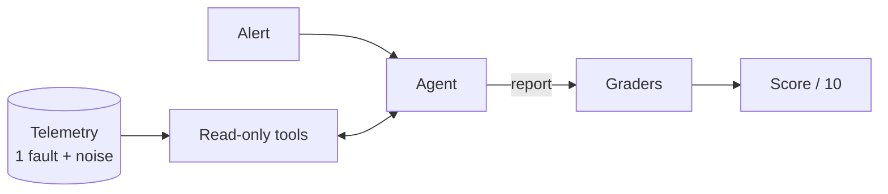
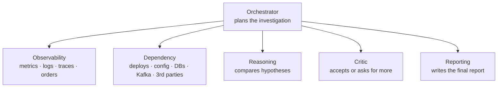

# TracerAgent

**An experiment: how well do AI agents handle incident response?**

This project benchmarks different AI agents and agent architectures on the same incidents. We want to know which models and which designs find the root cause of a production problem, and how well they do it.

> 📝 **Read the article with the results: [Benchmarking agents on incidents](https://files.ajitha.fyi/agents-on-incidents).**

## The experiment

Each agent gets an alert and 24 hours of telemetry from a fake online shop. One real fault is hidden in the data, together with normal noise. The agent investigates with read-only tools and writes a report. Then we give it a score.

We compare:

- **Models:** different LLMs.
- **Effort:** different reasoning levels.
- **Architectures:** one agent, or a team of agents.

## Agent architectures

### `single`: one agent

One agent gets all the tools. It reads the alert, calls tools in one loop and writes the report. This is the baseline.

### `multi`: a team of agents

An orchestrator agent leads a team. It calls the other agents as tools. Each agent sees only the text that the orchestrator sends to it.

## Run the experiment yourself

See **[RUNNING.md](RUNNING.md)**.

## License

[MIT](LICENSE)
